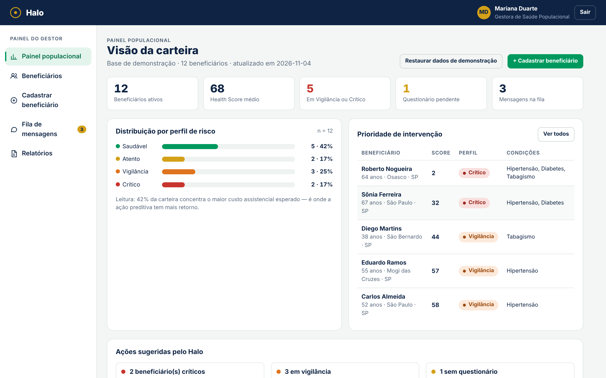
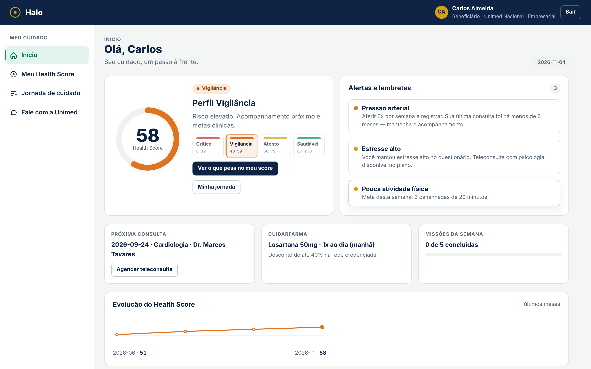

# Halo — Plataforma de Saúde Preditiva

Plataforma de saúde hiperpersonalizada desenvolvida para a **Unimed Nacional** no **FIAP Challenge 2026**, pelo **Squad Mercy**.

O Halo cruza dados clínicos e de estilo de vida de cada beneficiário para gerar um **Health Score de 0 a 100** e ajudar a operadora a agir antes que a doença se agrave: de uma operadora reativa para uma operadora preditiva.

> Ambiente de demonstração com dados fictícios. Na tela de login, use uma das contas de demonstração (qualquer senha é aceita).

## Funcionalidades

**App do beneficiário**
- Health Score de 0 a 100 com explicação dos fatores que pesam no resultado.
- Perfil de risco: Crítico, Vigilância, Atento ou Saudável.
- Alertas, lembretes, metas da semana e evolução do score ao longo dos meses.
- Jornada de cuidado por perfil de risco e consentimento conforme a LGPD.

**Painel do gestor**
- Visão da carteira: beneficiários ativos, Health Score médio e quantos estão em Vigilância ou Crítico.
- Distribuição por perfil de risco e lista de prioridade de intervenção.
- Cadastro de beneficiários, fila de mensagens e exportação de relatórios em CSV.

## Minha participação

- Definição de indicadores (Health Score) e mapeamento da jornada de cuidado do beneficiário.
- Estruturação do backlog e priorização de requisitos no Trello.
- Protótipos de interface do app do beneficiário e do dashboard de gestão populacional.

## Tecnologias

- HTML, CSS e JavaScript (página única, sem instalação)

## Como abrir

Baixe o arquivo `index.html` e abra no navegador.

## Equipe

Squad Mercy — FIAP, curso de Sistemas de Informação.
